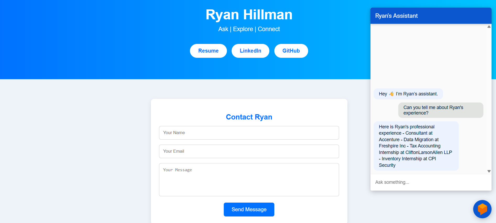

# Resume Chatbot

<p align="center">
  
  
</p>

This project allows visitors to explore my professional background with a chatbot.

---

## [Demo](https://youtu.be/-dResrRCJoQ)

---

## Screenshot



---

## Features
- Google Dialogflow ES: Handles intents like skills, programming languages, and small talk.
- Webhook (Flask on Cloud Run): Retrieves resume info from a JSON file in Cloud Storage.
- Chatbot embedded using Dialogflow Messenger.
- Links to a PDF version of my resume, LinkedIn, and GitHub.
- Contact Form implemented with [Formspree](https://formspree.io).
- GitHub Pages for static site hosting.
- Frontend built with HTML5 and CSS3.

---

## How to Run

### Resumes

Upload `docs/resume.json` and `docs/resume.pdf` to a public Cloud Storage bucket, then update the Resume link in `index.html`.

### Backend

```bash
cd backend
pip install -r requirements.txt
python main.py
```

Deploy to Cloud Run from the repo root (Dialogflow needs a public URL):

```bash
gcloud run deploy resume-webhook --source backend --allow-unauthenticated \
  --set-env-vars RESUME_URL=https://storage.googleapis.com/<your-bucket>/resume.json
```

### Dialogflow

1. Create a Dialogflow ES agent, zip the contents of `chatbot/`, and import it via **Settings → Export and Import → Restore From Zip**.
2. Under **Fulfillment**, enable the webhook and set the URL to `https://<your-cloud-run-url>/webhook`.

### Frontend

Enable **Integrations → Dialogflow Messenger** and paste your `agent-id` into `index.html`.

Replace the Formspree form ID in `index.html` with your own from [Formspree](https://formspree.io).

Open locally or host with GitHub Pages.

### Tests

```bash
cd backend
pip install -r requirements-dev.txt
pytest
```

---

## Webhook API

`POST /webhook` receives a [Dialogflow ES webhook request](https://cloud.google.com/dialogflow/es/docs/fulfillment-webhook#webhook_request) and replies with `{"fulfillmentText": "..."}`, chosen by the matched intent's display name. Intents are defined in `chatbot/intents/` and handled in `backend/main.py`.

```bash
curl -X POST http://localhost:8080/webhook \
  -H "Content-Type: application/json" \
  -d '{"queryResult": {"intent": {"displayName": "Languages"}}}'
```

---

See the [demo](https://youtu.be/-dResrRCJoQ) for a full walkthrough.
